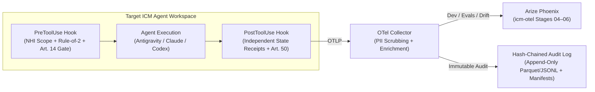
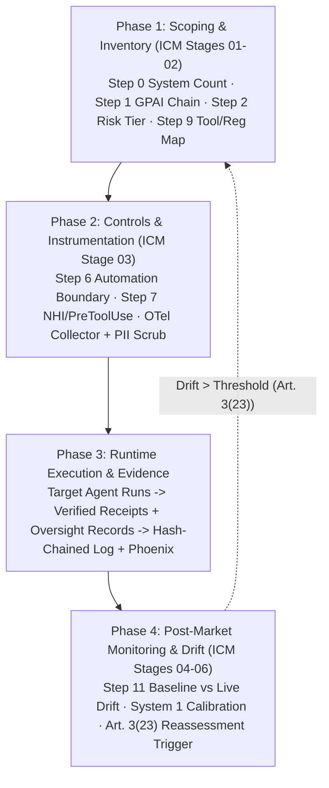

# OTel + ICM for EU AI Act Compliance Telemetry

> **Basis:** Synthesizes **Nannini et al. (2026), *"AI Agents Under EU Law: A Compliance Architecture for AI Providers"* (`arXiv:2604.04604v1`)** with the **`icm-otel`** workspace and **System 1 / System 2** evaluation architecture.
> **Purpose:** Explore how to evolve from *OTel for LLM evaluation* to *OTel + ICM for legally defensible EU AI Act (and parallel EU law) compliance recording and runtime governance*.

---

## 1. The Core Shift: From Eval Tracing to Compliance Evidence

Up to now, `icm-otel` has treated OpenTelemetry (OTel) and Arize Phoenix as **post-hoc evaluation telemetry**: capturing `CHAIN`, `LLM`, and `TOOL` spans to measure pass rates, tool-turn counts, latency, and shadow USD cost.

**Nannini et al. (2026)** demonstrate why **standard agent eval tracing is necessary but structurally insufficient for EU AI Act compliance**—and simultaneously reveal how an OTel + ICM architecture can close four critical regulatory gaps:

| Standard Eval Telemetry (`icm-otel` Today) | EU AI Act + Standards Requirement (`agentsundereulaw.pdf`) | Required Architectural Evolution |
| :--- | :--- | :--- |
| Logs agent text & tool names after execution (`PostToolUse`) | **Art. 12 & prEN ISO/IEC 24970:** Post-hoc reconstruction of causal action chains *and* **independent state verification** (agents can misreport completion—*Agents of Chaos*) | Capture **external state receipts** (file hashes, git diffs, HTTP status/IDs, DB rows), not just LLM text claims. |
| Captures full prompts/outputs in local Phoenix SQLite | **GDPR Art. 5/6/9 & AEPD (Feb 2026) Guidance:** Data minimisation, purpose-limited compartmentalised memory, PII redaction, and erasure support | Add a **GDPR PII redaction/pseudonymisation filter** at the OTel collector layer before persistence. |
| Evaluates traces offline in batches | **Art. 14 & prEN 18229-1 (Human Oversight):** Graduated **per-action** oversight (*retrospective*, *real-time*, *pre-execution*), logging stakeholder notification, decision, and rationale | Add **`PreToolUse` / `PreInvocation` enforcement hooks** + immutable oversight decision records. |
| Compares harnesses/models on a run | **Art. 3(23), Art. 43, Step 11 (Behavioral Drift):** Distinguish anticipated adaptive behavior from **substantial modification** via versioned runtime state | Record **runtime state snapshot hashes** (`CONTEXT.md`, tool catalogue, memory, model ID) + automated **drift alerts**. |
| Single `project_name` tag | **Step 9 (Regulatory Perimeter):** Obligations trigger from **external actions** across 8+ EU laws (GDPR, CRA, DSA, Data Act, DORA, NIS2, MDR, PLD) | Tag every tool & span with an **action-ontology + regulatory-trigger inventory**. |

---

## 2. Should This Enhance `icm-otel` or Become a New App?

### Option A: Enhance `icm-otel` Directly (Add a `--profile eu-compliance` Mode)
- **Pros:** Reuses `coding-harness-tracing` hooks, `audit_target.py`, `apply_config.py`, Phoenix UI, and `./icm-otel` CLI menus; fast to prototype.
- **Cons:** Conflates **mutable developer eval DBs** (where full prompt capture is helpful) with **immutable legal audit records** (which demand PII minimisation, retention controls, tamper-evidence, and `PreToolUse` blocking gates).

### Option B: Build a Separate App from Scratch (`eu-agent-audit`)
- **Pros:** Clean separation between dev evals and compliance records; strict security boundary.
- **Cons:** Duplicates OTel collector wiring, harness config generators (`Antigravity`, `Claude Code`, `Codex`), and target ICM discovery logic already built in `icm-otel`.

### Option C (Recommended): Layered Architecture — `icm-otel` Core + Dedicated Compliance Companion (`icm-compliance`)
Keep **`icm-otel`** as the **instrumentation, eval, and drift-benchmarking engine**, and build a dedicated **compliance telemetry & gate package/app** (initially a separate module/workspace consuming the same OTel stream) that enforces the four compliance-only guarantees:

**Why this split works:**
1. **Developers** keep using `icm-otel` freely with full payloads for prompt/ICM debugging and System 1/2 evals.
2. **Providers / Compliance Officers** route production or conformity-assessment runs through an **OTel Collector redaction pipeline** into **tamper-evident storage** (`prEN ISO/IEC 24970` + `GDPR` minimisation) with **`PreToolUse` human-authority enforcement** (`Art. 14` + `Art. 15(4)`).

---

## 3. Mapping the Paper's Core Concepts onto OTel + ICM

### 3.1 The Missing "Fourth Tier": Runtime Action Ontology + Graduated Oversight
Nannini et al. (Section 3 & Section 9(10)) propose a **4-level hierarchical action ontology** paired with live telemetry to decide *who* holds authority over an agent-proposed action *before* it runs:

$$\text{Domain} \rightarrow \text{Business Process} \rightarrow \text{Decision Type} \rightarrow \text{Action Instance}$$

Combined with ICM and OTel:
- **Domain & Process** come from the target ICM workspace (`GEMINI.md`/`AGENTS.md` + `stages/NN_*/CONTEXT.md`).
- **Decision Type** maps to the specific tool or stage output (`write_file`, `send_email`, `rank_candidates`, `deploy`).
- **Action Instance + Live Telemetry** (System 1 `Laya`/`Jev` confidence score, distributional drift score, affected-party sensitivity) computes the required **Art. 14 oversight modality**:
  - `retrospective` — low residual risk, reversible (logged to OTel; audited in Stage 04).
  - `realtime` — moderate risk; stream live to monitor UI with abort/undo window.
  - `pre_execution` — irreversible or high-risk (`Annex III` / financial / external comms / **AEPD "Rule of 2"** triggered); `PreToolUse` hook pauses only dependent branches (*dependency-aware selective continuation*) until a human approves and logs rationale.

### 3.2 AEPD "Rule of 2" & Privilege Minimization Outside the Model (`Art. 15(4)` / `prEN 18282`)
A system prompt saying *"do not delete files"* is not a security control (Section 6.1). Telemetry and enforcement must live **outside** the LLM:
- **Track Non-Human Identity (NHI) & Initiator Attribution:** Every `TOOL` span records whether the action was `human_initiated` vs `agent_initiated`, and the exact **least-privilege credential scope** granted for that call.
- **Detect the "Rule of 2" (Willison / Meta / AEPD Feb 2026):** Flag or block via `PreToolUse` any action chain simultaneously combining all three without human oversight:
  1. `untrusted_input` (e.g., web search results, external emails, RAG docs)
  2. `sensitive_data` (personal data, credentials, HR/health/financial records)
  3. `external_state_change` (sending emails, modifying DBs, committing/deploying, financial execution)

### 3.3 Independent State Verification (Closing the Self-Reporting Gap)
Because agents can falsely claim task completion while underlying state contradicts them (Section 8.2), the `PostToolUse` telemetry hook—not the LLM—must record **cryptographic/deterministic outcome proof**:
- File writes/edits -> SHA-256 hash + byte delta + `git diff --stat`
- Shell / CLI runs -> exit code + stdout/stderr digest
- External API calls -> HTTP status code + server-returned resource/transaction ID

### 3.4 Versioned Runtime State & Drift Detection (`Art. 3(23)` Substantial Modification)
Without a versioned runtime boundary, stochastic LLM variation and illegal **behavioral drift** are indistinguishable (Section 6.4, Step 11). A compliance-configured OTel span attaches a **`runtime_snapshot_hash`** covering:
1. Target `CONTEXT.md` & system instruction files (Git commit / file hashes)
2. Approved **tool catalogue** (exact MCP servers + tool schemas — flagging **dynamic tool discovery** if an unassessed tool appears!)
3. Persistent **memory state** hash & retention bucket (AEPD memory compartmentalisation)
4. Model identifier + temperature/harness version

Stage 04 / continuous monitoring then compares live spans against the **Conformity Baseline** (using System 1 calibration drift, tool-distribution shift, and error-rate deltas) to trigger **Step 11 -> Step 4 reassessment** when thresholds breach.

### 3.5 Exhaustive External-Action & Tool Inventory (`Step 9`)
Compliance triggers from **external effects**, not internal architecture (Table 5 & Step 9). Extending `icm-otel`'s `audit_target.py`, a compliance scanner inspects every tool/MCP server declared in a target ICM repo against the paper's four diagnostic questions:
1. Does this tool process **personal data** or electronic comms? -> **GDPR** (+ **ePrivacy Art. 5**)
2. Does it interface with a **connected product / related service**? -> **Data Act**
3. Does it **publish or moderate content** on a platform? -> **DSA** (+ **Art. 50(2)** synthetic marking)
4. Does it operate as **standalone networked software** or in a **regulated sector**? -> **CRA (M/606)** / **DORA** / **NIS2** / **MDR** / **Revised PLD**

---

## 4. Proposed Compliance OTel Semantic Schema (`eu_ai.*`)

These attributes extend OpenInference (`CHAIN`, `LLM`, `TOOL` spans) without breaking existing Arize Phoenix views:

| Span Attribute | Type | Applies To | Regulatory Anchor |
| :--- | :--- | :--- | :--- |
| `eu_ai.system_id` | `string` | All | Art. 3(1), Step 0 (distinct system count) |
| `eu_ai.risk_tier` | `enum` | Root `CHAIN` | Art. 6 (`prohibited_screen`, `annex_iii`, `annex_i`, `art_50_only`) |
| `eu_ai.runtime_snapshot_hash` | `string` | Root `CHAIN` | Art. 3(23), Step 11 (drift & substantial modification) |
| `eu_ai.ontology_node` | `string` | `TOOL` / `CHAIN` | `domain.process.decision_type.action_instance` (Sec. 3) |
| `eu_ai.initiator_kind` | `enum` | `TOOL` | `human` \| `ai_agent` \| `sub_agent` (Sec. 6.1) |
| `eu_ai.credential_scope` | `string` | `TOOL` | Least-privilege / NHI scope ID (prEN 18282, Step 7) |
| `eu_ai.rule_of_two` | `string[]` | `CHAIN` / `TOOL` | Subset of `["untrusted_input", "sensitive_data", "external_state_change"]` (AEPD) |
| `eu_ai.oversight.modality` | `enum` | `TOOL` / `CHAIN` | `retrospective` \| `realtime` \| `pre_execution` (Art. 14) |
| `eu_ai.oversight.approver_id` | `string` | `TOOL` | Pseudonymised natural-person authority ID (Art. 14) |
| `eu_ai.oversight.decision` | `enum` | `TOOL` | `approved` \| `rejected` \| `modified` \| `auto_executed` |
| `eu_ai.oversight.rationale` | `string` | `TOOL` | Human rationale recorded prior to irreversible action (Fn. 20) |
| `eu_ai.outcome.verified_receipt` | `string` | `TOOL` | Deterministic exit code / SHA-256 diff / API receipt ID (Sec. 8.2) |
| `eu_ai.affected_parties` | `string[]` | `CHAIN` / `TOOL` | External natural-person categories touched (Art. 13 / Art. 50) |
| `eu_ai.art50.disclosed` | `bool` | `CHAIN` / `TOOL` | Whether AI interaction disclosure / synthetic marking occurred |
| `eu_ai.gdpr.pii_redacted` | `bool` | All | Confirms Presidio/collector scrubbing prior to storage |
| `eu_ai.adjacent_regs` | `string[]` | `TOOL` | Activated triggers (`GDPR`, `CRA`, `DSA`, `DORA`, `NIS2`, `PLD`) |

---

## 5. Mapping Nannini et al.'s 12-Step Compliance Sequence to an ICM + OTel Pipeline

If built as a compliance pipeline (either as a dedicated `icm-compliance` workspace or a profile inside `icm-otel`), its stages map directly to the paper's 12 steps:
1. **`01_scope_and_gpai/` (Steps 0–2):** Count distinct AI systems/sub-agents, link upstream GPAI Art. 53 documentation (`model_registry.json`), and document Annex III / Annex I / Art. 50 classification + foreseeable misuse.
2. **`02_external_action_inventory/` (Step 9):** Scan the target workspace's tools/MCPs/APIs with the 4-question regulatory trigger mapper to emit `regulatory_map.json` and `ontology_policy.yaml` (mapping each tool to `retrospective` / `realtime` / `pre_execution`).
3. **`03_configure_compliance_otel/` (Steps 5–7):** Install `PreToolUse` least-privilege + Rule-of-2 + Art. 14 gate hooks, `PostToolUse` deterministic outcome-receipt hooks, and an OTel Collector config with GDPR PII redaction + retention tags.
4. **`04_audit_and_drift_monitor/` (Steps 10–11):** Verify immutable log integrity (SHA-256 chain), check Art. 14 oversight coverage on irreversible actions, detect uncatalogued dynamic tools, and measure runtime behavioral drift against the conformity baseline.
5. **`05_conformity_evidence_pack/` (Annex IV + Art. 73):** Export reproducible compliance evidence bundles (action-chain reconstructions, oversight logs, drift reports, serious-incident flags) alongside `icm-otel` quality scorecards.

---

## 6. Tooling Options (OSS / Free Default vs. Paid Alternatives)

| Capability | OSS / Free Primary Choice | Paid / Enterprise Alternative |
| :--- | :--- | :--- |
| **Telemetry Transport & PII Scrubbing** | **OpenTelemetry Collector (`otelcol-contrib`)** + transform/redaction processors | Datadog / Dynatrace / New Relic OTel pipelines |
| **PII Detection & Pseudonymisation** | **Microsoft Presidio** (OSS Python) / regex entity scrubber in collector | AWS Comprehend PII / Google Cloud DLP / Nightfall |
| **Dev Observability & Drift Exploration** | **Arize Phoenix** (local OSS `localhost:6006`) | Arize AX / LangSmith / Braintrust |
| **Immutable Audit Storage (Art. 12/18)** | Local **hash-chained JSONL/Parquet** + **MinIO** (OSS Object Lock) / SQLite + SHA-256 manifest | AWS S3 Object Lock (WORM) / GCP Cloud Logging Bucket Lock |
| **Pre-Execution Risk Gate (`Art. 14`)** | Deterministic Python `PreToolUse` hook + local **Laya** (Apache-2.0) confidence gate | **Jev** (TypeSafe AI) / Lakera Guard / enterprise OPA policy servers |
| **GRC / Conformity Documentation** | Markdown + JSON/YAML artifacts inside ICM workspace (Git-versioned) | OneTrust AI Governance / Vanta / Drata / Credo AI |

---

## 7. Practical Next Step (If Moving Forward)

To prototype this cleanly without disrupting `icm-otel`'s current eval workflow:
1. **Start small inside `icm-otel` Stage 02/03:** Extend `audit_target.py` with a `--compliance-inventory` flag that scans a target repo's tools/scripts against **Step 9's four regulatory questions** (GDPR, Data Act, DSA, CRA/Sectoral) and outputs a draft `regulatory_map.md`.
2. **Add an `eu_ai.*` compliance span template + hash-chained exporter** as an optional OTel Collector / Stage 04 module (`--compliance-export`), verifying `PreToolUse` Rule-of-2 detection and `PostToolUse` independent file/command checksums on a test repo before building a standalone compliance app.
