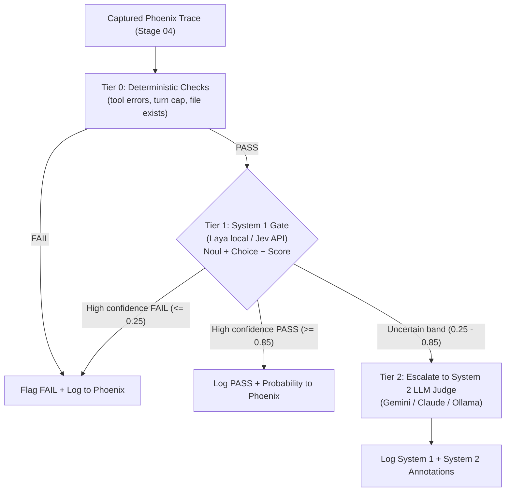

# System 1 Decision Models (Jev / Laya) in `icm-otel` — Design & ICM Integration

> **Scope:** Design proposal for introducing non-autoregressive **System 1 decision models** (**Jev**, **Laya**, or comparable calibrated classifiers) into `icm-otel`'s evaluation pipeline (Stages `04` & `06`) and building reusable System 1 harnesses with ICM.

---

## 1. Why System 1 Models Fit `icm-otel`

Today, `icm-otel` Stage 04 supports two evaluation tiers:
1. **Deterministic checks** (instant, free, zero variance — e.g., tool error rate, max tool turns).
2. **System 2 LLM-as-a-judge** (`arize-phoenix-evals` with Gemini / Claude / GPT / Ollama — flexible, but slower, generative, and sensitive to JSON formatting).

**System 1 decision models** bridge the gap between rigid regex/count rules and slow generative LLM judges. Instead of decoding prose token-by-token, a System 1 model takes a structured `state` and typed questions (**`Choice`**, **`Score`**, **`Noul`**) and outputs **calibrated probabilities** in a single forward pass (~9–33ms locally on Laya; single cloud round-trip on Jev).

| Option | License / Cost | Hosting | Latency | Strengths | Trade-offs |
| :--- | :--- | :--- | :--- | :--- | :--- |
| **Laya** (Convai Innovations) | **OSS (Apache-2.0)**, free local | Self-hosted (PyPI / Hugging Face / ONNX) | ~9–33ms local | Zero API cost, full data privacy, runs on laptop/CI, 100+ languages | Higher sensitivity to option ordering & wording; requires calibration check |
| **Jev** (TypeSafe AI) | **Commercial / Paid API** (`typesafe-sdk`) | Managed cloud API | ~100–300ms | Stronger out-of-the-box calibration (RLCD-trained), clean `Choice`/`Score`/`Noul` SDK | External API cost & data leaves local machine |
| **Hybrid Gate (Recommended)** | Free/Local first + Paid/System 2 on escalation | Local Laya + optional Gemini/Jev | Fast median, high recall | Filters clear PASS/FAIL locally; escalates uncertain cases to System 2 | Slightly more config in `eval_rubric.yaml` |

---

## 2. Critical Design Considerations (Especially Question Engineering)

Research on System 1 decision models (*"Fast Models, Slow Evidence"* / `sys1-eval`) shows that **small changes in question wording, rubric anchors, or option ordering can shift outputs dramatically** (for example, Laya has been observed flipping ~30% of choices when option order is reversed). Designing System 1 evals therefore requires treating **questions as tested software artifacts**, not casual prompts.

### 2.1 Choose the Right Primitive (`Noul` vs. `Choice` vs. `Score`)
- **`Noul` (Binary Probability `0.0..1.0`):** Use for single, atomic invariants (`"Does the output fabricate any file path or URL absent from the provided tool outputs?"`). Never combine two conditions with `"and"` inside one `Noul`.
- **`Choice` (Mutually Exclusive Labels + Probabilities):** Use for failure classification or stage routing (`grounded`, `unsupported_claim`, `incomplete_artifact`, `tool_loop`). Every option description must be mutually exclusive; add an explicit `"unclear_or_other"` option when cases may fall outside known buckets.
- **`Score` (Ordered Rubric Levels `0..K`):** Use for ordinal quality scales (`0 = missing required sections`, `1 = partial/unverified`, `2 = complete and grounded`). Anchor every level with observable evidence criteria—avoid vague adjectives like `"good"` or `"reasonable"`.

### 2.2 Guard Against Wording & Order Fragility
1. **Atomic, Neutral Phrasing:** Ask one question per primitive. Avoid leading phrasing (`"Confirm that the agent failed..."`) or double negatives.
2. **Option-Order Permutation Testing:** Before promoting a `Choice` or `Score` question into production, evaluate a small golden set of traces under **forward (`A, B, C`) and reversed (`C, B, A`)** option orders. Any question with high flip rate (`> 10–15%`) needs clearer mutually exclusive criteria—or should be routed to Jev / System 2 instead.
3. **Paraphrase Stability Check:** Test 2–3 semantically equivalent rewordings of `instructions`. High variance across paraphrases signals underspecified criteria.

### 2.3 Calibration & Confidence-Band Escalation
Raw probabilities are only useful for automated gating if they are calibrated:
- **Never hard-threshold uncalibrated scores at `0.50`.** Define **three zones**:
  - **Auto-PASS:** `p >= 0.85` (or `confidence >= 0.85`)
  - **Escalate to System 2 / Human:** `0.25 < p < 0.85` (the uncertain band!)
  - **Auto-FAIL:** `p <= 0.25`
- **Track Calibration Drift:** Compare System 1 decisions against System 2 LLM judge or human labels on a sample (`10–20%`) of traces using **Brier Score** or **Expected Calibration Error (ECE)**. If a local model (like Laya) is overconfident on errors, apply post-hoc temperature scaling or widen the escalation band.

### 2.4 Context Scoping (`state` Budget)
System 1 encoder backbones have much smaller context limits than frontier System 2 models and degrade if flooded with raw logs. In keeping with **ICM context discipline**, construct a compact `state` payload per span/trace:
- Stage `CONTEXT.md` summary (target requirements)
- User request / root `CHAIN` input
- Final artifact or `LLM` output + concise tool summary (counts, error messages, touched paths) — **not** 50KB of raw web-search HTML.

---

## 3. Integrating System 1 into `icm-otel` (Stages 04 & 06)

Rather than adding a mandatory new stage for every user, System 1 belongs as an **optional, project-specific extension in Stage 06** paired with **tiered execution in Stage 04**:



### Concrete Additions to Stage 06 (`06_extend_eval_rubric/`)
1. **New Menu Choice in `extend_rubric.py`:** `"Add / calibrate System 1 questions (Laya / Jev)"`.
2. **Calibration Smoke Check (`--test-sys1-stability`):** Runs candidate `Choice` / `Score` / `Noul` questions against `5–10` exported traces from `04_ingest_and_eval/outputs/eval_results.json` with **option-order permutation** and reports flip rate + confidence distribution *before* saving to `eval_rubric.yaml`.
3. **Extended `eval_rubric.yaml` Schema:**
   ```yaml
   system1_evals:
     enabled: true
     provider: "laya"          # "laya" (OSS local) | "jev" (TypeSafe cloud API)
     model: "laya-latest"      # or "jev-1.13.0"
     escalation_band: [0.25, 0.85]
     questions:
       - id: "grounded_outputs"
         type: "noul"
         instructions: "Are all cited file paths, URLs, and metrics present in the provided tool outputs or context?"
       - id: "failure_mode"
         type: "choice"
         instructions: "Classify the primary execution outcome of this trace."
         criteria:
           clean_completion: "Produced requested artifact with no unresolved errors"
           tool_loop: "Repeated similar tool calls without progressing toward the artifact"
           missing_context: "Blocked or guessed because required input files were absent"
   ```

### Concrete Additions to Stage 04 (`04_ingest_and_eval/`)
- Execute `system1_evals` **after** deterministic checks and **before** `--run-llm-eval`.
- Log each question's decision, probability, and `escalated_to_system2` flag back to Phoenix via `log_span_annotations_dataframe` (`annotator_kind="CODE"` or `"LLM"` with `sys1_` prefix).
- Only invoke the slower/costlier System 2 judge on traces inside `escalation_band` (or a random audit sample, e.g., `10%`), cutting judge cost and runtime substantially.

---

## 4. Using ICM to Build a System 1 Harness — and Supporting Other ICM Pipelines

### 4.1 How to Use ICM to Create a Jev/Laya Harness (vs. Non-ICM Alternative)

Building a reliable System 1 question suite is an iterative, human-in-the-loop workflow—which makes **ICM** a natural fit when designing and calibrating the harness itself:

```text
icm-sys1-harness/
├── AGENTS.md                        # Layer 0 orientation & Walk Test rules
├── CONTEXT.md                       # Pipeline router
├── 01_decision_inventory/           # Define exact decision points & state schemas
├── 02_question_authoring/           # Draft Choice / Score / Noul specs in YAML/JSON
├── 03_stability_and_calibration/    # Run permutation, paraphrase, & Brier/ECE checks
├── 04_threshold_and_escalation/     # Tune auto-pass / escalate / auto-fail bands
└── 05_export_harness/               # Emit clean Python/CLI module + eval_rubric.yaml block
```

* **Human Gates in the ICM Harness Builder:**
  - After `01_`: Approve the compact `state` fields (ensuring no context bloat).
  - After `02_`: Review exact question wording & mutually exclusive criteria.
  - After `03_`: Inspect permutation flip rates and ECE; rewrite any unstable question before exporting.
* **Non-ICM Alternative:** For a single simple binary check, you can skip a standalone ICM workspace and define `system1_evals` directly inside Stage 06 (`06_extend_eval_rubric/scripts/extend_rubric.py`) as a single YAML block + Python wrapper. Use the full `icm-sys1-harness` pipeline when you have **5+ high-stakes decisions** (e.g., EU AI Act tiering, compliance gating, or multi-stage routing).

### 4.2 How an ICM-Built System 1 Harness Supports Another ICM Pipeline

Once calibrated and exported, the System 1 harness can support any target ICM workspace (such as `career-catalyst-icm` or an EU AI Act pipeline) in three ways:

1. **Post-Hoc Telemetry Triage (`icm-otel` Stage 04):**
   Scores every trace from Antigravity, Claude Code, and Codex in milliseconds, annotates Phoenix, and escalates only borderline traces to System 2.
2. **Pre-Gate Screening at Target Stage Boundaries:**
   Before interrupting a human at a target ICM stage's Human Gate, a deterministic stage script runs the calibrated System 1 harness on the generated artifact (e.g., `stages/02-role-prep/output/*.md`) to flag missing sections, policy violations, or ungrounded claims immediately.
3. **Anti-Loop / Early-Stop Guardrail During Execution:**
   Recall trace `19bc283134fd` in `career-catalyst-icm` (`55` tool spans, `31` `search_web` calls, `356s`). A lightweight `Noul` check (`"Does the current search state already contain enough sources to draft the stage output?"`) can signal when an agent should stop searching and synthesize—cutting latency and quota burn without waiting for a full System 2 reflection turn.
