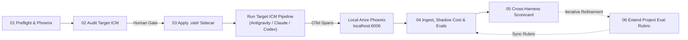
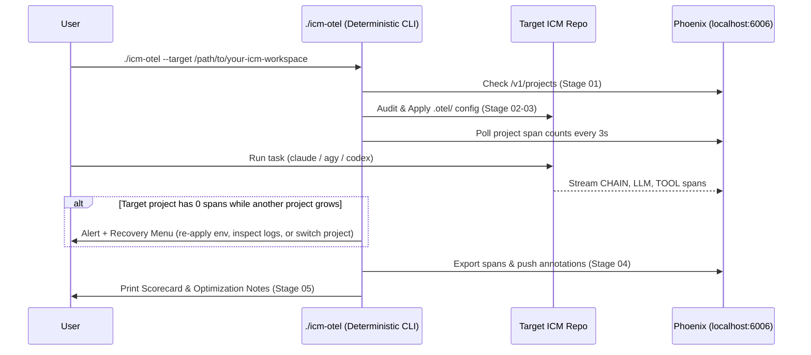

# icm-otel User Guide

## 1. First-Time Setup & Installation

Follow these steps once on a new machine after cloning `icm-otel` from GitHub.

### Prerequisites (Free / OSS Defaults)
- **[`uv`](https://docs.astral.sh/uv/)** (recommended — manages an isolated Python `3.11–3.13` `.venv` automatically even if your system Python is newer, e.g., `3.15`):
  ```bash
  # macOS (Homebrew)
  brew install uv
  # Or Linux / macOS official installer
  curl -LsSf https://astral.sh/uv/install.sh | sh
  ```
- One or more agent harnesses installed locally: **Antigravity (IDE or `agy` CLI)**, **Claude Code (`claude`)**, **OpenAI Codex (`codex`)**, and/or **Gemini CLI (`gemini`)**.
- *(Optional, for free local LLM-as-a-judge evals)* **[Ollama](https://ollama.com/)** installed locally.

### Machine Bootstrap
1. **Install `icm-otel` dependencies:**
   ```bash
   git clone <your-fork-or-repo-url>
   cd icm-otel
   uv sync
   ```
2. **Start local Arize Phoenix** in a dedicated terminal window (serves UI + OTLP receiver on `http://localhost:6006`):
   ```bash
   uvx arize-phoenix serve
   ```
   *(Alternative: `docker run -p 6006:6006 arizephoenix/phoenix:latest`, or OSS Jaeger/SigNoz, or paid Phoenix Cloud / Arize AX.)*
3. **Install global tracing hooks** via [`Arize-ai/coding-harness-tracing`](https://github.com/Arize-ai/coding-harness-tracing) for the harnesses you use (select **Phoenix** and `http://localhost:6006` when prompted):
   ```bash
   curl -sSL https://raw.githubusercontent.com/Arize-ai/coding-harness-tracing/main/install.sh | bash -s -- antigravity
   curl -sSL https://raw.githubusercontent.com/Arize-ai/coding-harness-tracing/main/install.sh | bash -s -- claude
   curl -sSL https://raw.githubusercontent.com/Arize-ai/coding-harness-tracing/main/install.sh | bash -s -- codex
   # Optional exact-token Gemini baseline:
   curl -sSL https://raw.githubusercontent.com/Arize-ai/coding-harness-tracing/main/install.sh | bash -s -- gemini
   ```
   > **Important for Codex CLI:** Codex blocks newly registered hooks until you trust them. Open `codex`, run `/hooks`, and approve every `arize-hook-codex-*` entry.
4. **Launch the CLI app** pointed at any target ICM workspace:
   ```bash
   ./icm-otel --target /path/to/your-icm-workspace
   ```

---

## 2. Architecture & Pipeline Flow

`icm-otel` separates **instrumentation** from **execution**: you configure a target ICM workspace once, run your target ICM pipeline normally in Antigravity, Claude Code, or Codex, and evaluate the captured traces on demand in local **Arize Phoenix (`http://localhost:6006`)**.



### Live Monitoring & Recovery Flow (`./icm-otel`)



---

## 3. Pipeline Stages Explained Simply

| Stage | What It Does (Plain Terms) | Inputs | Outputs | Human Check |
| :--- | :--- | :--- | :--- | :--- |
| **`01_preflight_and_server/`** | Confirms Arize Phoenix is running on `localhost:6006` and checks that global hooks are wired for Antigravity, Claude Code, and Codex. | Machine `~/.gemini/`, `~/.claude/`, `~/.codex/` | `outputs/preflight_report.md`, `outputs/env_manifest.json` | Phoenix loads + hooks ok + 1-turn smoke trace visible |
| **`02_target_audit_and_plan/`** | Scans an existing ICM repo (classic root stages or nested `stages/*`), maps its outputs, and drafts a config plan + eval rubric without editing the target yet. | Target ICM workspace root | `outputs/target_audit.md`, `outputs/instrumentation_plan.md`, `outputs/eval_rubric.yaml` | Approve proposed files & rubric before touching target repo |
| **`03_apply_otel_config/`** | Writes `.otel/phoenix.env`, `.otel/eval_rubric.yaml`, and `.claude/settings.local.json` into the target repo (gitignored in `sidecar` mode) and runs a Walk Test check. | Stage 02 plan & rubric | `outputs/applied_changes.md` + target `.otel/` files | Inspect target `git status`, Walk Test PASS |
| **`04_ingest_and_eval/`** | Pulls traces from Phoenix, estimates **shadow tokens & USD cost** for Antigravity spans, runs deterministic & optional LLM-as-a-judge evals, and pushes annotations back to Phoenix. | Live Phoenix spans, `eval_rubric.yaml`, `model_pricing.json` | `outputs/traces_raw.parquet`, `outputs/eval_results.json`/`.csv`, `outputs/shadow_cost_report.md` | Audit low-scoring traces & cost assumptions |
| **`05_compare_and_report/`** | Aggregates traces by harness and model into a Pass Rate vs. Tool-Turn vs. Cost scorecard and proposes concrete `CONTEXT.md` improvements. | Stage 04 `eval_results.json` | `outputs/scorecard.md`, `outputs/icm_optimization_notes.md` | Decide which harness/model & `CONTEXT.md` edits to adopt |
| **`06_extend_eval_rubric/`** | *(Optional / Iterative)* Adds project-specific deterministic bounds, domain LLM-judge presets (e.g. **EU AI Act**), or custom criteria without affecting other projects. | `eval_rubric.yaml`, `presets/` | `outputs/eval_rubric.<project>.yaml` (synced to target `.otel/`) | Confirm custom criteria match project domain |

---

## 4. Supported ICM Directory Structures & Customization

Always point `--target` at your target **workspace root** (never inside a `stages/` subfolder). `audit_target.py` and `apply_config.py` support both classic ICM layouts and nested/variant layouts out of the box.

### Layout A: Classic ICM (Root-Level Numbered Stages)
```text
my-classic-icm/
├── AGENTS.md              # or CLAUDE.md / GEMINI.md (Layer 0)
├── CONTEXT.md             # Layer 1 workspace router
├── 00_reference/          # Shared static reference (skipped as a stage)
├── 01_research/
│   ├── CONTEXT.md         # Layer 2 stage instructions
│   └── outputs/
└── 02_draft/
    ├── CONTEXT.md
    └── outputs/
```

### Layout B: Nested Container / Non-Classic ICM (`stages/`, `pipeline/`, etc.)
```text
my-nested-icm/
├── GEMINI.md              # or AGENTS.md / CLAUDE.md
├── CONTEXT.md
├── _config/               # Non-stage config
└── stages/                # Or pipeline/, workflows/, phases/
    ├── 01-intake/
    │   ├── CONTEXT.md     # Or README.md / SKILL.md / PROMPT.md
    │   └── output/        # Singular `output/` or plural `outputs/`
    ├── 02-analysis.md     # Standalone stage Markdown files are also detected
    └── custom-review/     # Any subfolder containing a context file is detected
```

### What Is Detected Automatically
- **Root orientation files:** `AGENTS.md`, `CLAUDE.md`, `GEMINI.md`, `CONTEXT.md`, `README.md`, `.gitignore`
- **Stage folder names (`STAGE_NAME_RE`):** `01_foo`, `01-foo`, `1_foo`, `stage_01`, `step-1` (case-insensitive)
- **Container folders (`STAGE_CONTAINER_DIRS`):** `stages/`, `pipeline/`, `workflows/`, `phases/`
- **Stage spec files (`CONTEXT_FILENAMES`):** `CONTEXT.md`, `README.md`, `SKILL.md`, `PROMPT.md`, `context.md` (plus standalone `*.md` files inside containers)
- **Declared outputs:** Extracts both bullet lists and Markdown output tables (`| Artifact | Location | ... |`) and checks both `outputs/` and `output/` directories.

### How to Customize for a Different Target Setup
If your workspace uses a convention outside the defaults above, edit these constants directly:

1. **Custom container directory (e.g., `steps/`, `modules/`, `tasks/`):**
   - Add the folder name to `STAGE_CONTAINER_DIRS` in `02_target_audit_and_plan/scripts/audit_target.py`.
   - Update `_run_walk_test()` in `03_apply_otel_config/scripts/apply_config.py` (where `stages_dir = target / "stages"`) if you also want the Stage 03 Walk Test check to descend into that container.
2. **Custom root-level stage naming (e.g., unnumbered `intake/`, `synthesis/` at repo root):**
   - Broaden `STAGE_NAME_RE` in `02_target_audit_and_plan/scripts/audit_target.py` (and the matching regex inside `_run_walk_test()` in `03_apply_otel_config/scripts/apply_config.py`), or move those stages under a container folder listed in `STAGE_CONTAINER_DIRS` with a `CONTEXT.md` inside each.
3. **Custom instruction filename (e.g., `INSTRUCTIONS.md`, `SPEC.md`):**
   - Add it to `CONTEXT_FILENAMES` in `02_target_audit_and_plan/scripts/audit_target.py` (and update `(d / "CONTEXT.md").is_file()` in `_run_walk_test()` in `03_apply_otel_config/scripts/apply_config.py`).
4. **Extra folders to exclude from discovery (e.g., `fixtures/`, `archive/`):**
   - Add them to `IGNORE_DIRS` in `02_target_audit_and_plan/scripts/audit_target.py`.
5. **Custom stage output paths for evaluation:**
   - Edit `target_stages:` directly in `<target>/.otel/eval_rubric.yaml` (or `02_target_audit_and_plan/outputs/eval_rubric.yaml`) after running Stage 02.

---

## 5. When You Don't Need to Start from Stage 1

| Situation | Where to Start | Command (`./icm-otel` Menu or Direct) |
| :--- | :--- | :--- |
| **Phoenix & hooks already set up; adding a new target repo** | **Stage 02** | `./icm-otel --target /path/to/new-repo` -> `[3] Stage 02` |
| **Target repo already configured; you just ran new tasks** | **Stage 04** | `./icm-otel` -> `[6] Stage 04` (or `[5] Live Monitor` while running) |
| **You already ran Stage 04 and want a fresh summary** | **Stage 05** | `./icm-otel` -> `[7] Stage 05` |
| **You want stricter or domain-specific evals for one project** | **Stage 06 -> 04 -> 05** | `./icm-otel` -> `[8] Stage 06`, then re-run `[6]` and `[7]` |

Saved project profiles live in `.icm-otel/projects.json` (gitignored), so switching between target repos preserves each project's settings and `.otel/eval_rubric.yaml`.

---

## 6. Interactive CLI App (`./icm-otel`)

`./icm-otel` (`icm_otel_cli.py`) is **100% deterministic Python** — it needs **no LLM** to run and operates outside any agent harness sandbox.

```bash
cd /path/to/icm-otel
./icm-otel                               # Interactive project picker + control center
./icm-otel --target /path/to/icm-repo    # Jump straight in with a target workspace
```

### Menu Options & Recovery Behavior
1. **Guided Flow:** Runs `01 -> 02 -> 03 -> Live Monitor -> 04 -> 05` with confirmation prompts at each gate.
2. **Stages `01`–`06`:** Run any individual stage on demand (`Stage 04` automatically uses `<target>/.otel/eval_rubric.yaml` when present).
3. **Live Monitor (`[5]`):** Polls Phoenix every 3 seconds while you execute your target pipeline. If your target project receives 0 spans while another Phoenix project (e.g., `icm-otel` or `default`) grows, it raises a **Trace Routing Diagnosis Menu** to re-apply env configs, tail `~/.arize/harness/logs/*.log`, or pull from the active project instead.
4. **Recovery Menus:** If Phoenix is down, `.venv` isn't synced, or an LLM judge API key is missing, the CLI offers numbered choices (launch Phoenix in background, run `uv sync`, switch judge to local Ollama, or run deterministic-only).

---

## 7. Script & CLI Flag Reference

### Stage 01 — `01_preflight_and_server/scripts/preflight_check.py`
```bash
python3 01_preflight_and_server/scripts/preflight_check.py [--endpoint URL] [--output-dir DIR] [--skip-network]
```
- `--endpoint`: Phoenix URL (default `http://localhost:6006` or `$PHOENIX_ENDPOINT`).
- `--output-dir`: Override output directory (`env_manifest.json`, `preflight_report.md`).
- `--skip-network`: Skip HTTP check to Phoenix (offline test mode).

### Stage 02 — `02_target_audit_and_plan/scripts/audit_target.py`
```bash
python3 02_target_audit_and_plan/scripts/audit_target.py \
  --target /path/to/target-repo \
  [--project-name icm-slug] \
  [--mode sidecar|tracked] \
  [--harnesses antigravity claude_code codex gemini_cli] \
  [--endpoint http://localhost:6006]
```
- `--target`: Workspace root of the target ICM repo (do **not** pass a `/stages` subfolder).
- `--mode sidecar` *(default — personal / non-invasive)*: Appends `.otel/` and `.claude/settings.local.json` to `.gitignore` and leaves `AGENTS.md`/`CLAUDE.md`/`GEMINI.md` untouched. Use for local experimentation or repos where you don't want telemetry files in Git history.
- `--mode tracked` *(shared / versioned)*: Leaves `.otel/` tracked in Git and appends a 4-line `## Telemetry (OTel + Local Arize Phoenix)` note to the target's Layer 0 doc (`AGENTS.md`, `CLAUDE.md`, or `GEMINI.md`). Use when:
  1. **Sharing across teammates or machines** (e.g., committing a project's `eval_rubric.yaml` for a compliance/EU AI Act pipeline alongside the repo itself).
  2. **Walk Test visibility:** You want any fresh agent opening the repo to see in its Layer 0 doc that `.otel/phoenix.env` exists and should be sourced in CLI sessions.

### Stage 03 — `03_apply_otel_config/scripts/apply_config.py`
```bash
python3 03_apply_otel_config/scripts/apply_config.py [--dry-run] [--claude-symlink] [--target PATH] [--project-name NAME] [--mode sidecar|tracked]
```
- `--dry-run`: Preview all target changes without writing outside `icm-otel`.
- `--claude-symlink`: Creates `CLAUDE.md -> GEMINI.md` in target if `GEMINI.md` exists and `CLAUDE.md` is missing.

### Stage 04 — `04_ingest_and_eval/scripts/ingest_and_eval.py`
```bash
uv run python 04_ingest_and_eval/scripts/ingest_and_eval.py \
  [--list-projects] \
  [--project NAME [NAME ...]] \
  [--all-projects] \
  [--rubric path/to/eval_rubric.yaml] \
  [--limit 500] \
  [--run-llm-eval --judge-provider google|litellm|openai|anthropic --judge-model MODEL] \
  [--input-file path/to/spans.jsonl] \
  [--no-push]
```
- `--list-projects`: Print all project names currently on Phoenix and exit.
- `--project`: One or more Phoenix project names to pull (defaults to `eval_rubric.yaml`'s `project_name`).
- `--all-projects`: Pull spans across every project on the Phoenix server.
- `--rubric`: Path to a project-specific `eval_rubric.yaml` (e.g., `<target>/.otel/eval_rubric.yaml`).
- `--run-llm-eval`: Run `arize-phoenix-evals` LLM-as-a-judge classifiers defined in `eval_rubric.yaml`.
  - Free local OSS judge: `--judge-provider litellm --judge-model ollama/llama3.2` (requires `uv pip install litellm` and `ollama`).
  - Gemini judge: `--judge-provider google --judge-model gemini-2.5-flash` (requires `GEMINI_API_KEY`).
- `--input-file`: Re-evaluate an exported `.jsonl` or `.parquet` file offline.
- `--no-push`: Skip uploading `estimated_tokens`, `shadow_cost_usd`, and LLM judge annotations to Phoenix.

### Stage 05 — `05_compare_and_report/scripts/generate_scorecard.py`
```bash
python3 05_compare_and_report/scripts/generate_scorecard.py [--input path/to/eval_results.json] [--output-dir DIR]
```

### Stage 06 — `06_extend_eval_rubric/scripts/extend_rubric.py`
```bash
uv run python 06_extend_eval_rubric/scripts/extend_rubric.py \
  [--rubric path/to/eval_rubric.yaml] \
  [--preset eu_ai_act_rubric] \
  [--add-criterion NAME "Prompt description"] \
  [--max-tool-turns 40] \
  [--max-error-rate 0.10] \
  [--no-sync-target]
```
- Run with no flags for the **interactive numbered menu**.

---

## 8. Extending Rubrics & Annotations (Example: EU AI Act Risk Assessment)

Every target project can maintain its own rubric in `<target>/.otel/eval_rubric.yaml` (and `06_extend_eval_rubric/outputs/eval_rubric.<project>.yaml`).

### Guided Example: Adding EU AI Act Evals
1. **Launch Stage 06:**
   ```bash
   uv run python 06_extend_eval_rubric/scripts/extend_rubric.py --rubric /path/to/eu-ai-act-icm/.otel/eval_rubric.yaml
   ```
   Or non-interactively:
   ```bash
   uv run python 06_extend_eval_rubric/scripts/extend_rubric.py \
     --rubric /path/to/eu-ai-act-icm/.otel/eval_rubric.yaml \
     --preset eu_ai_act_rubric
   ```
2. This merges [`06_extend_eval_rubric/presets/eu_ai_act_rubric.yaml`](../06_extend_eval_rubric/presets/eu_ai_act_rubric.yaml), adding:
   - `eu_ai_act_risk_tier_accuracy` (Art. 5 Prohibited / Art. 6 & Annex III High-Risk / Art. 50 Limited-Risk / Minimal Risk classification)
   - `eu_ai_act_obligations_completeness` (Arts. 9–15 / Art. 50 obligations proportional to risk tier)
   - `grounded_regulatory_citations` (verifies no fabricated articles or file paths)
   - `max_tool_turns_per_stage: 40` and `max_error_rate: 0.10`
3. **Add your own criterion & custom `choices`:** Edit `llm_judge_evals.criteria` in `<target>/.otel/eval_rubric.yaml` or pick menu option `[2]` in `extend_rubric.py`. Stage 04 automatically reads `choices` (e.g. `{"COMPLIANT": 1.0, "NON_COMPLIANT": 0.0}`) and pushes every criterion score back to Phoenix as an `LLM` span annotation via `to_annotation_dataframe()`.

---

## 9. Troubleshooting Common Issues

| Symptom | Cause | Fix |
| :--- | :--- | :--- |
| **Traces land in `icm-otel` or `default` instead of target project** | Ran agent from the `icm-otel` directory instead of target repo, or `PHOENIX_PROJECT` wasn't exported in terminal / Antigravity IDE used global `~/.arize/harness/config.json`. | Always `cd` into the target workspace. For Claude Code, `.claude/settings.local.json` sets `PHOENIX_PROJECT` automatically. For Antigravity CLI, run `source .otel/phoenix.env && agy`. |
| **`audit_target.py` finds 0 stages** | Pointed `--target` at a `/stages` subfolder instead of repo root, or repo uses custom folder/context filenames. | Pass the **repo root** to `--target`; see [Section 4](#4-supported-icm-directory-structures--customization) to customize `STAGE_CONTAINER_DIRS`, `STAGE_NAME_RE`, or `CONTEXT_FILENAMES`. |
| **Codex hooks never fire** | Codex CLI blocks newly installed hooks until explicitly trusted. | Open `codex`, run `/hooks`, and approve every `arize-hook-codex-*` entry. |
| **`422 Unprocessable Content` pushing annotations** | Calling `log_span_annotations()` with a flat DataFrame instead of `log_span_annotations_dataframe()`. | Fixed in `ingest_and_eval.py` (uses `log_span_annotations_dataframe`). |
| **`ValueError: cannot insert context.span_id, already exists`** | Phoenix returns `context.span_id` as both index and column. | Fixed in `ingest_and_eval.py` (`_df_to_records` uses `reset_index(drop=True)`). |
| **Python 3.15 wheel build errors** | System Python `3.15` is newer than some binary wheels. | Use `uv sync` / `uv run` (`pyproject.toml` pins `>=3.11,<3.14`). |
| **`--run-llm-eval` fails with missing API key** | No `GEMINI_API_KEY` / `OPENAI_API_KEY` exported. | Export `GEMINI_API_KEY` or pass `--judge-provider litellm --judge-model ollama/llama3.2` for free local evals. |
